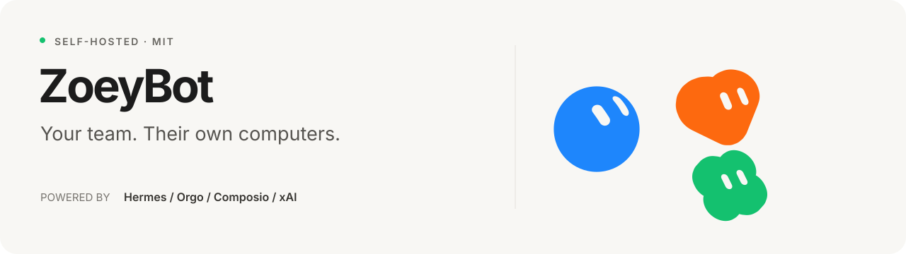
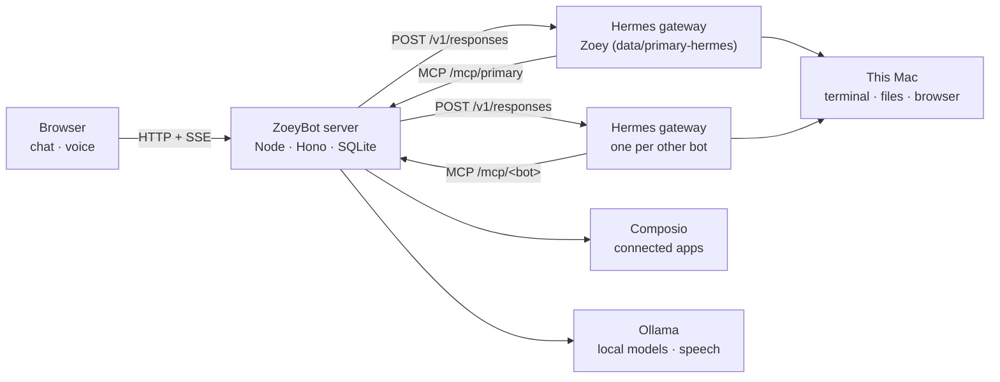

<p align="center">
  
</p>

<p align="center">
  A multi-bot command center that runs on your Mac.<br>
  <a href="https://github.com/NousResearch/hermes-agent">Hermes Agent</a> runs every bot, each in its own Hermes home, on the host itself. No VM, no cloud computer.
</p>

<p align="center">
  <a href="#what-you-get">What you get</a> ·
  <a href="#how-it-fits-together">How it works</a> ·
  <a href="#run-it-on-the-mac">Run it</a> ·
  <a href="docs/ARCHITECTURE.md">Architecture</a> ·
  <a href="#status-and-limits">Limits</a>
</p>

<p align="center">
  
  
  
</p>

<p align="center">
  <picture>
    <source media="(prefers-color-scheme: dark)" srcset="assets/screenshots/chat-dark.png">
    
  </picture>
</p>

---

ZoeyBot is a team of AI agents you chat with from one place. **Zoey** is the primary bot; the current team around her is **Coder, Researcher, Market Watch, Email Triage, PC Builder** and **Sourcing**. Each bot has its own name, look, memory, model, working directory and tool allowlist. Bots can ask each other for help, run recurring routines, keep a task list, save files to a Library, and talk with you over voice.

## What you get

| | |
|---|---|
| **Chat that shows the work** | While a bot works you see what it is doing right now, how long it has been at it, and each step it took. Finished turns fold into a "Worked for 2m 10s · 7 steps" chip you can open. |
| **One Hermes home per bot** | Every bot is a separate Hermes agent with its own home, gateway, model, memory and skills. Zoey's home is `data/primary-hermes`; the others live under `ENGINES_DIR`. |
| **Host execution** | With `HQ_HOST=1` every bot runs on this Mac. Its terminal and file tools work in the bot's own `cwd`, limited to the toolsets you allow in its Engine panel. There is no VM and no remote computer. |
| **Bot to bot** | The `ask_bot` tool lets any bot ask another by name, either waiting for the answer or leaving a task whose result is posted back. Both transcripts show the exchange. |
| **Model and subscription per bot** | Pick the provider and model in the bot's Engine panel. Local Ollama models are listed from the running Ollama; subscriptions are signed in through Hermes' own auth flow. |
| **Connected apps with approvals** | Bots ask for the app they need and you connect it through Composio. Actions that write (send, post, delete) wait for your OK on a card in the chat. |
| **Voice** | Talk to a bot over a voice call; real work is handed to the same bot, with the same memory and tools. Local speech (Ollama TTS, offline STT) is supported. |
| **Routines, tasks and a Library** | Recurring jobs on a schedule, a task list per bot, and a place where bots save the files they make. |

## How it fits together



- **Everything runs on the Mac host.** The server, every Hermes gateway, Ollama, and the bots' terminal and file tools. Nothing is provisioned in a VM or a cloud computer.
- **Zoey is the primary bot.** Her gateway (`data/primary-hermes`, port 8642) is managed outside the app; the app only calls its API and never rewrites or restarts it.
- **Every other bot gets its own Hermes home and gateway**, started by the app, with its own model, memory, `cwd` and toolset allowlist.
- **The app's tools reach Hermes over MCP.** The server exposes `/mcp/<bot>`, giving each agent connected apps, tasks, routines, the Library and `ask_bot`.

More detail is in the [architecture guide](docs/ARCHITECTURE.md) and [docs/local-hermes-engine.md](docs/local-hermes-engine.md).

### How this relates to Hermes Bot Mode

Hermes Desktop has its own Bot Mode. ZoeyBot uses the same Hermes engine but does **not** use Bot Mode: it has its own bot layer on top of the gateway's HTTP API.

| | ZoeyBot | Hermes Bot Mode |
|---|---|---|
| A bot is | A separate Hermes home | A Hermes profile |
| Gateways | One per bot | One, serving every profile |
| Transport | HTTP, `/v1/responses` | JSON-RPC over WebSocket |
| Routines | The app's own scheduler | Hermes cron jobs |
| Bot to bot | `ask_bot` (blocking answer, or a task whose result is posted back) | Hermes' `message_agent` tool |

Bots made here do not show up in Hermes Desktop's Bots tab, and bots made there do not show up here.

## Run it on the Mac

You need **Node.js 22 or newer**, Ollama, ffmpeg, and a checkout at `/Users/thehound/zoeybot` with `.env` filled in (`cp .env.example .env`; the comments explain each key).

The supported way to run the stack is the launchd lifecycle in `scripts/local-services.py` (Ollama on 11434, the web/API server on 8787, Zoey's gateway on 8642). It never auto-starts at login; start it explicitly:

```bash
cd /Users/thehound/zoeybot
npm ci && npm run build
python3 scripts/local-services.py install        # generates data/launchd/*.plist and ~/Applications/ZoeyBot.app
python3 scripts/local-services.py start --open-browser
python3 scripts/local-services.py status
python3 scripts/local-services.py stop
```

Launchd labels are `com.thehound.zoeybot.{ollama,web,engine}`. Opening **ZoeyBot.app** does the same `start`. See [docs/local-macos-launcher.md](docs/local-macos-launcher.md).

For development without launchd:

```bash
npm run dev -w server     # API on :8787 (HQ_HOST=1 in .env)
npm run dev -w web        # app on :5173
```

`DEV_LOGIN=1` enables the email-only sign-in form; never set it on a public address. The database is `data/zoeybot.db` (`DB_PATH`).

## Development

```bash
npm run typecheck                          # server and web
node --import tsx --test tests/*.test.ts   # unit and route tests
python3 tests/local-services-test.py -v    # launchd lifecycle
```

```text
server/src/         API, Hermes adapter (agent/loop.ts), engines (engine.ts), MCP endpoint (mcp.ts)
web/src/            chat, bot settings, app connections, voice
scripts/            launchd lifecycle and macOS launcher, Hermes config helper, sign-in link
tests/              node:test suites, launchd tests, live smokes
docs/               architecture and local-stack notes; the xAI/Composio guide is historical
```

## Status and limits

- Experimental, no security audit. Bots run as your user on this Mac, limited only by their toolset allowlist and `cwd`.
- Approval cards cover Composio write actions. What a bot does through its terminal or browser is not gated.
- Host mode (`HQ_HOST=1`) is the only mode; the former Orgo/UTM screen-per-bot code was removed (`docs/cleanup-inventory.md`).

## License and credits

Project code is available under the [MIT license](LICENSE). The bot artwork and some icons derive from xAI's Grok Bot design and remain the property of their owners, as do third-party app logos; the MIT license does not cover them. See [third-party notices](THIRD_PARTY_NOTICES.md).

Built with [Hermes Agent](https://github.com/NousResearch/hermes-agent), [Composio](https://composio.dev) and [Ollama](https://ollama.com). This is an independent project, unaffiliated with xAI or Nous Research.
